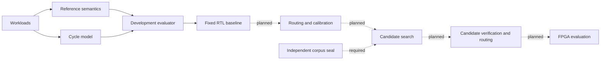

# Architecture Lab

[](https://github.com/logohere/architecture-lab/actions/workflows/check.yml)
[](LICENSE)

An open-source FPGA research platform for reproducible, AI-assisted processor architecture exploration.

Architecture Lab is an open-source research toolkit for investigating how computational workloads map to processor architectures. Its initial research target is arithmetic graph execution on a small FPGA. The goal is to make architecture experiments repeatable, comparable and inspectable, rather than to optimize a single benchmark or report unverified performance gains.

**Research direction:** inspired by [Architect Labs’ Frostbite research](https://architectlabs.com/blog/frostbite): graph computation, fast executable models, independent verification and architecture exploration. Frostbite uses dynamic interaction-net reduction and formal contracts; our initial core instead implements a restricted, static arithmetic DAG. This is an independent FPGA research project, not a Frostbite implementation or an ML accelerator. ASIC development is out of scope. No Frostbite performance or power claims apply here.

**Status:** early research software. The Rust model, deterministic scheduler and public development evaluator are implemented. Reviewer-side corpus validation and trusted baseline execution are implemented; a real independently sealed corpus, untrusted candidate execution, automated architecture search, routed FPGA implementation, formal verification and physical measurements are not yet available. A fixed one-lane SystemVerilog baseline and reproducible simulation workflow are implemented and tested in CI.

## Research approach

A reference model establishes expected behavior. Candidate search follows baseline verification, model calibration and an independently sealed evaluation corpus. See the [implementation plan](specs/architecture-lab/plan.dog) for the evidence gates.



The current model executes a restricted arithmetic graph using unsigned 32-bit wrapping addition and multiplication. Each node has unit modeled latency and each non-root node has a single consumer. The scheduler executes ready nodes across a configurable number of lanes. It does not model memory, interconnect, physical timing or power.

See [SPEC.dog](specs/architecture-lab/SPEC.dog) for authoritative semantics and [constitution.dog](specs/architecture-lab/constitution.dog) for evidence and promotion rules.

## Getting started

### Requirements

- Git and Rust 1.97.1 or newer, including Cargo.
- Rustfmt and Clippy for development.
- Bun 1.3+ or Node.js 22.12+ for the pinned Dotdog CLI.
- No FPGA, proprietary EDA tool, cloud service or external Rust dependency is required for the current model.

Clone and run:

```sh
git clone https://github.com/logohere/architecture-lab.git
cd architecture-lab
cargo run --locked -- bench
cargo test --locked
```

### Benchmark

The public development suite contains mixed arithmetic, serial dependency chains, balanced reduction and integer wraparound workloads. Each is evaluated with 1, 2, 4 and 8 lanes.

Example rows:

```csv
workload,lanes,output,modeled_cycles
mixed,1,100,7
mixed,2,100,4
mixed,4,100,3
mixed,8,100,3
```

The output is CSV on standard output. Failures produce diagnostics on standard error and a nonzero exit code. To save the results:

```sh
cargo run --locked -- bench > benchmark.csv
```

The public benchmark inputs can also be exported with `cargo run --locked -- bench-inputs`. Reviewers can validate an externally controlled corpus using `node scripts/verify-holdout.mjs <external-corpus.json>`; the custody and seal requirements are defined in [SPEC.dog](specs/architecture-lab/SPEC.dog). No actual private corpus is distributed.

Run any valid arithmetic graph through the baseline:

```sh
printf 'lit:2;lit:3;add:0:1\n' | cargo run --locked -- run 2
```

The result is `5,2` under the `output,modeled_cycles` header. Reviewers can append `--baseline` to the external corpus validation command to check exact modeled cycles independently and record the executable SHA-256. Use only trusted baseline source; this does not sandbox arbitrary candidates.

The evaluator checks independently specified outputs and necessary cycle bounds. These checks are not a proof of execution-trace correctness. Modeled cycle counts are not measured FPGA performance or estimates of silicon energy efficiency.

## RTL baseline

The fixed streaming core implements one arithmetic node per accepted input beat for graphs of up to 63 connected nodes. It uses a valid/ready interface and validates operand ownership. Simulate against the Rust public suite and directed negative controls using Icarus Verilog (iverilog and vvp on PATH) and Node.js:

```sh
node scripts/check-rtl.mjs
```

See [the RTL contract](specs/architecture-lab/SPEC.dog#scenario-rtl-baseline). This is behavioral simulation, not synthesis, routing or a measured FPGA benchmark.

## Local FPGA implementation

With AMD Vivado (Zynq-7000 device support), Git and Node.js on PATH, run the fixed core out of context from the repository root:

```sh
vivado -mode batch -nolog -nojournal -source fpga/vivado/ooc.tcl -tclargs 20
```

The initial 20 ns clock target is an engineering assumption (50 MHz), not a measured frequency. The flow targets `xc7z007sclg400-1`, limits Vivado to four threads and prevents concurrent runs through a per-user lock. Each ignored `experiments/runs/` directory retains source and constraint hashes, tool identity, stage/error status, checkpoints, utilization, route status, and timing including unconstrained paths. For full console output, use a unique external log path with Vivado's `-log` option instead of `-nolog`. A stale `.architecture-lab-vivado.lock` in the home directory must only be removed after confirming no run is active. Review the raw reports, including I/O constraints and DRC, before accepting evidence. No board timing, bitstream or physical test is implied.

The orchestration tests use Tcl command doubles, not Vivado: `node --test scripts/check-vivado-flow.test.mjs` (requires `tclsh`). Actual synthesis and routing remain unverified.

## Hardware and tooling

| Target | Status |
|---|---|
| Rust software model | Implemented |
| Public development benchmark suite | Implemented |
| Fixed single-lane SystemVerilog core | Implemented; behavioral simulation in CI |
| [Digilent Cora Z7-07S](https://digilent.com/shop/cora-z7-zynq-7000-single-core-for-arm-fpga-soc-development/) | Target: XC7Z007S-1CLG400C; board integration pending |
| Vivado out-of-context implementation | Batch flow implemented; actual routing evidence pending |
| Physical performance or power measurement | Not yet available |

Hardware programming is not part of the current CLI or CI workflow. The repository does not require a specific vendor cloud service. Toolchain and target changes must be justified against the research goals.

## Repository layout

| Path | Purpose |
|---|---|
| `src/lib.rs` | Arithmetic graph validation, reference evaluation and scheduler |
| `src/benchmarks.rs` | Fixed public development workloads and evaluator |
| `src/main.rs` | Command-line benchmark interface |
| `tests/` | Model, validation and evaluator tests |
| `rtl/` | Fixed FPGA baseline and SystemVerilog testbench |
| `scripts/check-rtl.mjs` | Rust-derived simulation vectors and RTL verification |
| `specs/architecture-lab/` | Canonical human-authored Dotdog specifications |
| `.github/workflows/check.yml` | Rust and Dotdog verification |
| [AGENTS.md](AGENTS.md) | Instructions for coding agents |
| [CONTRIBUTING.md](CONTRIBUTING.md) | Contributor workflow and checks |

## Specification-driven development

[Dotdog](https://github.com/specdog/dotdog) 1.0.0 is the specification and graph tooling used by this project.

| Specification | Responsibility |
|---|---|
| [SPEC.dog](specs/architecture-lab/SPEC.dog) | Product behavior, architecture and scenarios |
| [data-model.dog](specs/architecture-lab/data-model.dog) | Entities, properties and relationships |
| [constitution.dog](specs/architecture-lab/constitution.dog) | Research integrity, security and engineering constraints |
| [plan.dog](specs/architecture-lab/plan.dog) | Implementation phases and completion criteria |

From the repository root:

```sh
bunx dotdog@1.0.0 refresh --if-stale --json
bunx dotdog@1.0.0 query Program
bunx dotdog@1.0.0 validate
bunx dotdog@1.0.0 check --json
```

With npm, substitute `npx --yes dotdog@1.0.0` for `bunx dotdog@1.0.0`. Generated graph artifacts are local and excluded from version control. Dotdog checks complement Rust tests; they are not a substitute for tests or formal verification.

## Releases and compatibility

The project is in initial `0.x` development and follows [Semantic Versioning 2.0.0](https://semver.org/) with ROS 2-inspired [release and compatibility practices](https://reps.openrobotics.org/rep-2004/). Cargo metadata is the package version source of truth. See the [version policy](specs/architecture-lab/constitution.dog#version-policy) for public contracts, compatibility rules and release requirements. The [changelog](CHANGELOG.md) records user-visible changes; an approved tagged release is distinct from development on main.

## Contributing

Start with the [implementation plan](specs/architecture-lab/plan.dog) and [open issues](https://github.com/logohere/architecture-lab/issues). Discuss scope in an issue, make a focused branch, and open a pull request with tests and reproducible evidence. Update the relevant specifications with any intentional change to behavior.

AI-assisted contributors should follow [AGENTS.md](AGENTS.md). Claude Code can discover the same instructions through [CLAUDE.md](CLAUDE.md). Human and agent contributions follow the same review and verification requirements.

See [CONTRIBUTING.md](CONTRIBUTING.md) for the complete local verification workflow, [SECURITY.md](SECURITY.md) for vulnerability reporting, and [CHANGELOG.md](CHANGELOG.md) for changes.

## License

Apache License 2.0. See [LICENSE](LICENSE). Contributions are accepted under the same license.
